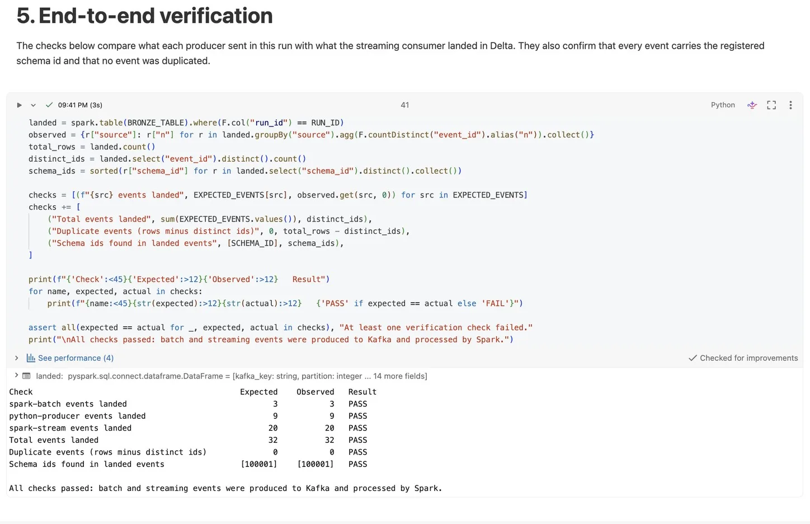
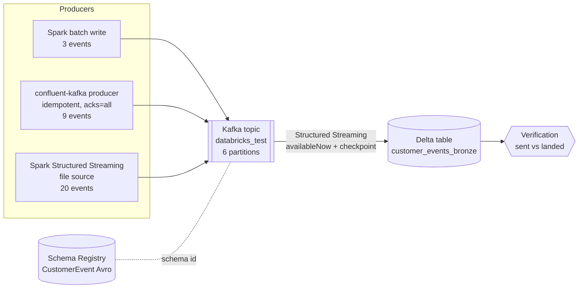
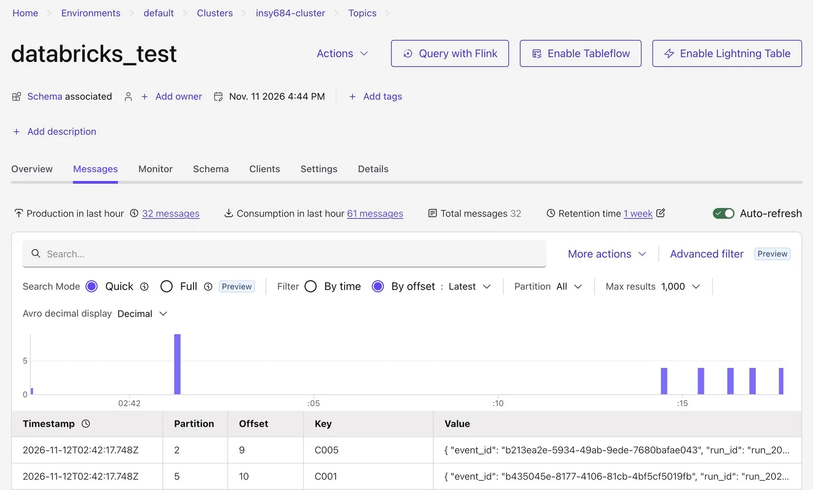

# Kafka to Spark, verified end to end

**Three producers, one Avro contract, and a check that proves every event arrived exactly once.**

A course pipeline written in 2022 no longer ran on 2026 platforms. I rebuilt it on Confluent Cloud and Databricks, gave it a registered data contract, and ended it with a verification step that compares what was sent with what landed.

[Case study](https://tasnimrh.github.io/work/kafka-spark-streaming/) | [Notebook](kafka_spark_streaming.ipynb) | McGill INSY 684, Enterprise Machine Learning in Production, November 2026 | Solo

## Result

| Check | Expected | Observed | Result |
|---|---:|---:|:---:|
| Spark batch events landed | 3 | 3 | PASS |
| Python producer events landed | 9 | 9 | PASS |
| Spark streaming events landed | 20 | 20 | PASS |
| Total events landed | 32 | 32 | PASS |
| Duplicate events (rows minus distinct ids) | 0 | 0 | PASS |
| Schema ids found in landed events | 1 | 1 | PASS |

The notebook stops with an error if any of these checks fails, so lost or duplicated data halts the run instead of reaching a report.

## Architecture

## What I built

1. **A data contract.** A `CustomerEvent` Avro schema registered in Confluent Schema Registry. An enum rejects a misspelled event type at write time, a UUID per event makes duplicates detectable, `run_id` and `source` record lineage, and optional fields keep the schema able to evolve.
2. **One wire format for every producer.** Spark's `to_avro` writes only the Avro body. Small helpers add and strip the Confluent header (magic byte plus schema id), so messages from Spark and from the Python client are identical and decode both in Confluent and in Spark.
3. **Three ways in.** A Spark batch write, an idempotent `confluent-kafka` producer, and a Structured Streaming job fed by arriving files.
4. **One way out.** A streaming consumer lands the topic in a bronze Delta table using a checkpoint and the `availableNow` trigger, which Databricks serverless compute supports.
5. **Proof.** A final cell compares events sent per producer with events landed, counts duplicates, and confirms a single schema id.

## What I fixed in the 2022 code

| Problem in the provided notebook | Fix |
|---|---|
| `bootstrap.servers = "..."` is not valid Python | Plain constant `BOOTSTRAP_SERVERS` |
| API key and secret typed into every cell | Databricks secret scope; options defined once |
| Written for Databricks Community Edition, now retired | Targets Free Edition serverless compute |
| Default streaming trigger is rejected on serverless | `trigger(availableNow=True)` with `awaitTermination()` |
| Checkpoints under legacy DBFS root paths | Unity Catalog volumes |
| Streaming job read a topic and wrote back into it, doubling the data every run | Producer reads files; consumer writes to Delta |
| `display()` on a stream starts a rejected query | Stream lands in Delta; the table is displayed |
| Plain JSON with no schema | Registered Avro schema, Confluent wire format |
| `subscribe` passed to the Kafka writer, where it is ignored | Writer uses `topic` only |

## Run it

You need a Confluent Cloud cluster with Schema Registry enabled and a Databricks workspace (Free Edition works).

1. Create a topic called `databricks_test` in Confluent Cloud.
2. Import `kafka_spark_streaming.ipynb` into Databricks.
3. Run the cell in section 1.2 once to store your four API values in a secret scope called `confluent`, then clear the values.
4. Set `BOOTSTRAP_SERVERS` and `SCHEMA_REGISTRY_URL` in section 1.3.
5. Run all. The last cell prints the verification table.
6. Run the clean-up cell in section 7 and delete the Confluent cluster so no credits are used.

Dependency: `confluent-kafka[avro,schemaregistry]==2.16.1` (see `requirements.txt`). Each run tags its events with a `run_id`, so the notebook can be re-run safely.

## Limits

- Synthetic customer events at small scale. This shows correctness and pipeline design, not throughput.
- Spark's Kafka sink delivers at least once. Duplicates are detectable by `event_id`, but downstream de-duplication is not built yet.
- `availableNow` processes on demand. A low-latency version would run as a scheduled Databricks job.

## Stack

Apache Kafka (Confluent Cloud) · Confluent Schema Registry · Avro · PySpark Structured Streaming · Databricks (serverless, Unity Catalog) · Delta Lake · confluent-kafka Python client

---

Built by [Tasnim Hassan](https://tasnimrh.github.io). The starting notebook was provided by the course; the rebuild, schema, verification and write-up are my own.
